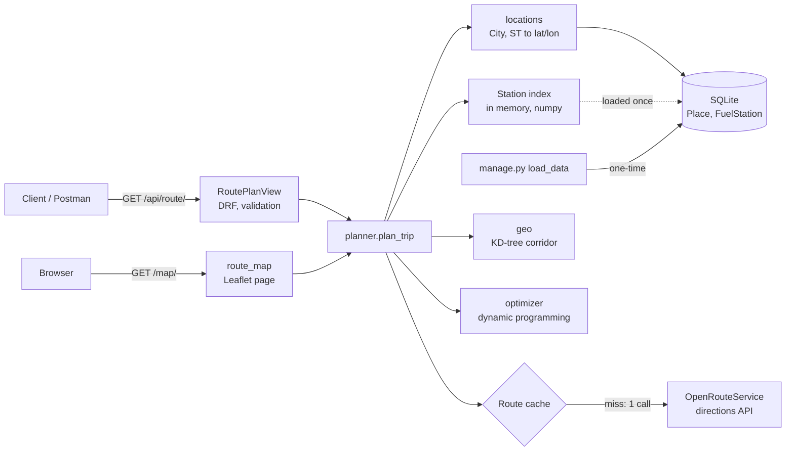
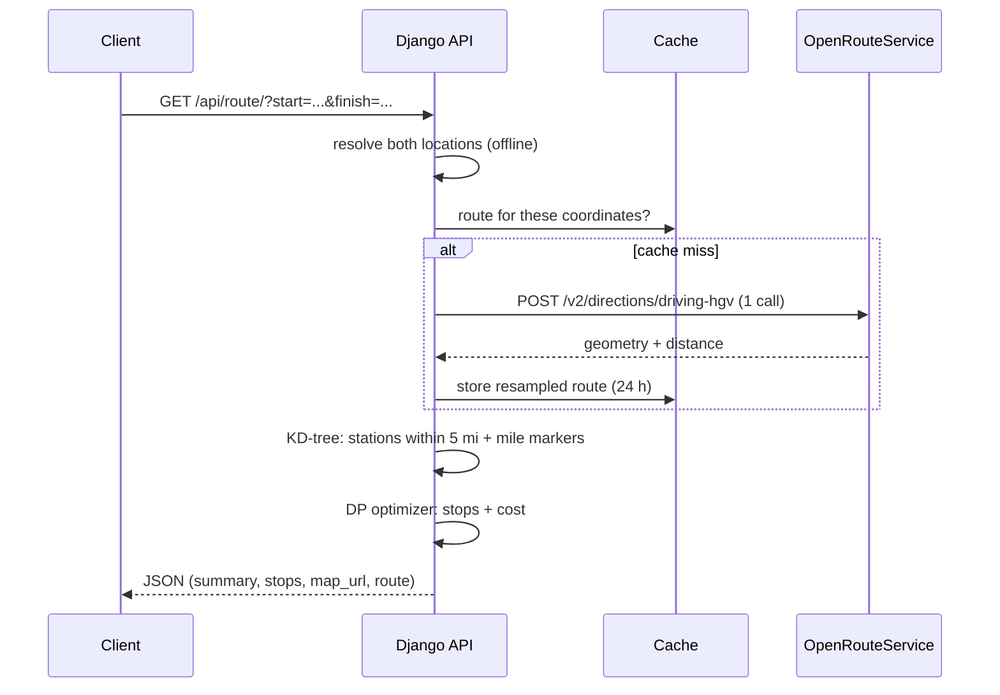

# Design and walkthrough

This document goes in the order I approached the problem: requirements → data → decisions → architecture → algorithm → code → non-functional concerns.

## 1. Requirements

| Requirement | How it is met |
|---|---|
| Start and finish inside the USA | `City, ST`, `City, State` or `lat,lon`, resolved offline and checked against US bounds |
| Map of the route | GeoJSON `route` in the response, plus a Leaflet map at `map_url` |
| Cost-effective fuel stops | Dynamic programming: cheapest fuel plus a small cost per stop, solved exactly (section 5) |
| 500-mile range, multiple stops | Tank = 500 mi ÷ 10 mpg = 50 gal; the plan never exceeds it |
| Total fuel cost at 10 mpg | `summary.total_fuel_cost_usd`; total gallons = distance ÷ 10 |
| Use the provided price file | Loaded once by `manage.py load_data` |
| Free map/routing API | OpenRouteService (`driving-hgv` truck profile); OpenStreetMap tiles |
| Latest stable Django | Django 6.1 + Django REST framework |
| Fast responses | ~25 ms of our own work on a coast-to-coast trip; the routing call adds 1–2 s only the first time |
| Few routing API calls (1 ideal) | **Exactly 1** per new trip, **0** for repeated trips and for the map |

## 2. What the data told me

I inspected the CSV before designing anything:

- **8,151 rows but only 6,738 unique station IDs.** 597 IDs appear more than once with different prices. I keep the **lowest** price, which is what a driver would pay.
- **It includes Canadian provinces** (AB, BC, ON, QC…). These are excluded because the task is USA only. That leaves **6,626 US stations**.
- **There are no coordinates.** Addresses are highway exits such as `I-44, EXIT 283 & US-69`, which geocoding APIs handle poorly.
- **But there are only 4,275 distinct cities.** That makes offline, city-level geocoding practical.

## 3. Key decisions and trade-offs

| Decision | Why | Trade-off |
|---|---|---|
| **Geocode stations offline to city level** (bundled US places table) | No API calls; 100% of US stations matched; runs in ~3 s once | Position is the city centre, not the exact exit |
| **OpenRouteService `driving-hgv`** | Free, truck-aware routing, returns geometry and distance in one call | Free quota (2,000 routes/day), so results are cached |
| **One routing call, cached by coordinates** | Meets the "1 call" requirement; repeated trips and the map cost 0 calls | Cache must be shared across workers in production (Redis supported) |
| **Resample the route to 1 point per mile** | Uniform accuracy (≤ 0.5 mi) and a small payload (~60 KB for a coast-to-coast trip) | Curves are slightly smoothed on the map |
| **KD-tree corridor search** | Finds stations within 5 mi of the route in O(S log R) | Uses a radius, not exact distance to each road segment |
| **DP optimizer with a cost per stop** | Exact optimum; avoids extra stops to save a cent per gallon; `stop_cost=0` gives the pure cheapest | Positions rounded to 0.5 mile inside the optimizer |
| **Stations held in memory; SQLite** | The data is static and small (6.6k rows), so the DB isn't on the request path | Restart the server after reloading the data |

## 4. Architecture



Request flow:



## 5. The fuel algorithm

**The problem.** Stations near the route are sorted by mile marker. The tank holds 500 miles of fuel (50 gallons). We need to decide where to stop and how much to buy at each stop so that we never run dry and the total cost is as low as possible.

**What "optimal" means here.** If we minimise fuel cost alone, the result is technically cheapest but unrealistic. On the real New York → Los Angeles route it makes **16 stops**: it buys 1.7 gallons in Omaha and stops again 17 miles later to save 0.6¢ a gallon. A stop costs a truck time, so I give every stop a cost (**$10 by default**, configurable, and `stop_cost=0` turns it off) and minimise **fuel cost + stop cost**.

**Dynamic programming.** Fuel is measured in units of 0.5 mile of range (the tank holds 1,000 units). Walking the stations in route order, we keep one array:

```
best[f] = cheapest cost to be at this station with f units of fuel
```

- **Buy here** (price `c` per unit): reaching level `f` from a lower level `g` costs `best[g] + c·(f − g) + stop_cost`. The best `g` for every `f` is a running minimum of `best[g] − c·g`, so all levels are updated in one O(T) pass.
- **Drive** `d` units to the next station: `best` shifts down by `d`, and levels below zero are impossible.
- At the destination, take the cheapest level, then walk back to recover where and how much we bought.

**Start:** the truck starts with just enough fuel to reach its first stop, which is the cheapest station within 25 miles of the start, or the first station on the route if there is none. That fuel is billed at the first stop, so total gallons = distance ÷ 10 mpg.

**Reserve:** the optimizer plans with 485 of the 500 miles, so every leg leaves a 15-mile reserve. That covers the detour to a station up to 5 miles off the road, and the city-level positions.

**Correctness:** the tests compare the optimizer with exact solvers on 60 random routes. With `stop_cost = 0` they use a linear program; with `stop_cost = 10` they use a mixed-integer program. Both match.

**Complexity:** O(n · T), for n stations on the route and T = 1,000 fuel levels. Finding the stations is O(R log R + S log R) with a KD-tree. A coast-to-coast request takes about 25 ms of our own compute.

**Real results** (OpenRouteService routes, provided price file):

| Trip | Cheapest fuel only (`stop_cost=0`) | Default (`$10` per stop) |
|---|---|---|
| New York → Los Angeles (2,792 mi) | 16 stops, $853.35 | **7 stops, $862.01** (+1.0%) |
| Chicago → Denver (1,002 mi) | 5 stops, $297.41 | **3 stops, $297.82** (+0.1%) |
| Dallas → Houston (233 mi) | 1 stop, $64.10 | 1 stop, $64.10 |

**Worked example** (from the tests): stations at mile 0 ($3.00) and mile 30 ($2.99); the trip is 400 miles.
- Cheapest fuel: 3 gal at $3.00 to reach mile 30, then 37 gal at $2.99, for **$119.63 with 2 stops**.
- With $10 per stop: 40 gal at $3.00, for **$120.00 with 1 stop**. That's 37¢ more but one fewer stop, so it wins.

## 6. Code tour

| File | What it does |
|---|---|
| `routing/views.py` | DRF endpoint, input validation and error mapping; the map view |
| `routing/services/planner.py` | Orchestrates one trip; caches the route |
| `routing/services/optimizer.py` | The DP fuel optimizer; no Django, easy to test |
| `routing/services/geo.py` | Haversine, route resampling, KD-tree corridor search |
| `routing/services/ors.py` | OpenRouteService client: one POST, clear errors |
| `routing/services/locations.py` | Parses `City, ST` / `lat,lon`; US bounds check |
| `routing/services/stations.py` | Loads all stations into numpy arrays once per process |
| `routing/management/commands/load_data.py` | Filters, deduplicates and geocodes the CSV, atomically |
| `routing/templates/routing/map.html` | Leaflet map with the route and numbered stops |

## 7. Non-functional concerns

- **Performance:** no database access on the hot path (stations are in memory), vectorised numpy (KD-tree and a DP done with array operations), a 1-point-per-mile route, and a route cache. The heavy geometry comes last in the response.
- **External API usage:** 1 call per new trip, 0 when cached. Concurrent requests for the same new trip wait for one call instead of each making their own. "No route" answers are cached for an hour. Per-IP rate limiting (60/min), shared by the API and the map page, protects the free quota. The client IP comes from the socket, not a spoofable `X-Forwarded-For`, unless `DJANGO_BEHIND_PROXY` is set.
- **Consistent errors:** every error, including 404, 500, throttling and wrong HTTP method, returns `{"error": {"code", "message"}}`. Unhandled exceptions are logged with their traceback.
- **Reliability:** 10 s timeout; transient failures (dropped connection, 502/503/504) are retried twice with backoff over a keep-alive session. Provider errors map to our own messages: 422 when the trip can't be routed, 502 for anything else (details go to the log, not the client), 503 for quota or key problems, 504 on timeout.
- **Security:** secrets come from the environment (`.env` is git-ignored), and the app refuses to start without a secret key when DEBUG is off. Input lengths are validated, map popups escape station data, and the app has a minimal surface (no admin, sessions or auth).
- **Observability:** every routing call is logged with its timing. Each response includes `meta` (routing API calls, cache hit, stations considered, elapsed ms).
- **Testability:** 126 tests with no network. The optimizer is a pure function checked against LP/MILP solvers.
- **Scalability:** the web tier is stateless. With `REDIS_URL` set (required for more than one worker), all workers share the route cache, the request lock and the rate-limit counters. `/api/health/` is there for load balancers.

## 8. Limitations and next steps

- **City-level station positions.** Using exit numbers or a geocoded address list would allow a tighter corridor and real detour distances.
- **Detours aren't priced.** A station up to 5 miles off the route is treated as being on it; the 15-mile reserve keeps that safe. Adding each station's detour to its cost is a small extension to the DP.
- **The "in the USA" check** for raw coordinates is "within 25 miles of a US city", so points just across the border (Tijuana, Vancouver) are accepted.
- **The routing call is synchronous.** It ties up a worker for up to about 10 s. At scale, move route fetching to a task queue or an async view.
- **Larger datasets:** move stations to PostGIS and use `ST_DWithin` along the route line.
- **Prices change:** schedule `load_data` against a live price feed.
